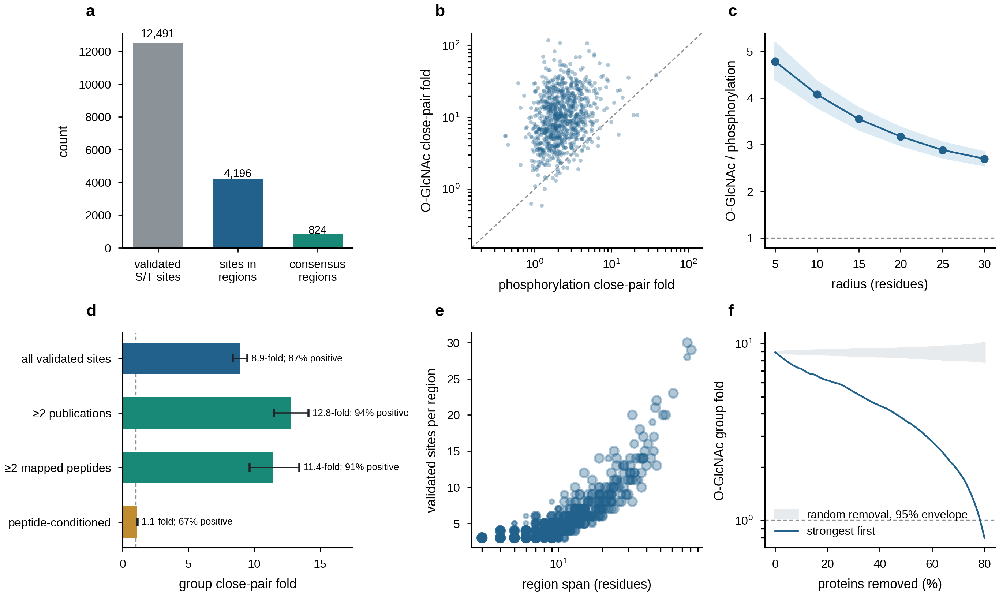

# Sweet spots

[](https://github.com/filiprumenovski/sweet-spots/releases/tag/v1.1.0)
[](https://doi.org/10.5281/zenodo.21922595)
[](https://www.python.org/)
[](https://snakemake.readthedocs.io/)
[](LICENSE)

## Reproduce everything with one command

Open a terminal on a Mac or Linux computer and paste:

```bash
git clone https://github.com/filiprumenovski/sweet-spots.git
cd sweet-spots
./reproduce
```

When the run finishes, its last line says:

```text
REPRODUCED. Every frozen scientific check passed.
```

You do not need to install Python, set up an environment or download any data:
the script fetches everything itself, checks every download, recomputes
every result from scratch, and compares each number with the published values.

| | |
|---|---|
| **You need** | macOS or Linux, an internet connection, 8 GB of RAM, 4 GB of free disk |
| **How long** | about 77 minutes on a 10-core laptop; about 20 minutes on a 96-core server (see below) |
| **If it stops** | run `./reproduce` again; it picks up where it left off |
| **If it fails** | it prints which step failed; details are in `results/logs/reproduce.log` |
| **Results** | figures in `results/figures/`, numbers in `results/analysis/`, full report in `results/review/index.html` |
| **To start over** | delete the folder and clone again |
| **Windows** | not supported directly; use WSL 2 with Ubuntu and run the same three lines there |
| **No `git`?** | download the [ZIP](https://github.com/filiprumenovski/sweet-spots/archive/refs/heads/main.zip), unzip it, open a terminal in the folder and run `bash reproduce` |

### Expected run time

| Computer | Time |
|---|---|
| Laptop, 10 cores (Apple M4) | about 77 minutes |
| Server, 96 cores (AMD EPYC) | about 20 minutes |

Fewer cores take proportionally longer. Running it again after it finishes takes a
minute or two.

<details>
<summary>What the command does, step by step</summary>

1. Checks the computer (operating system, cores, memory, disk).
2. Downloads a pinned copy of `uv` and Python 3.12.13 into `.tools/`, verifies their
   checksums, and installs every package at the exact version in `uv.lock` into
   `.venv/`. Python, conda or uv settings already on the computer are ignored.
3. Downloads all input data (the open-data release and the supplemental archive, with
   Zenodo as a backup source) and checks every file against
   `reference/input_manifest.json`.
4. Deletes the retained results and recomputes all analyses, figures and tables using
   every CPU core.
5. Runs the audit: every reported number, sensitivity row, prediction table and figure
   is compared with the archived reference. It prints `REPRODUCED` and writes
   `results/audit/PASS` only if every check passes.

Nothing is installed outside the `sweet-spots` folder. Older HPC systems (glibc older
than 2.28) can use Apptainer instead; see [portable reproduction](docs/portable_reproduction.md).

</details>

## About

Reproducible analyses for *Sweet spots: how a promiscuous glycosyltransferase
reads a conserved regional code*.

This repository rebuilds the operational O-GlcNAc region catalogue, every
reported computational analysis, five main and four supplemental figures, a
machine-readable result ledger, and the terminal integrity audit. Retained
results are included for immediate inspection; the Snakemake workflow recreates
them from frozen inputs. The two-stage region construction is defined precisely
in the [region definition guide](docs/region_definition.md).

<p align="center">
  
</p>

## Running individual steps

The `make` targets remain for development (they expect `uv` on `PATH`):

```bash
make install          # locked environment
make inputs           # open inputs only; see the input data guide for the rest
make validate-inputs  # record every input digest
make dry-run          # inspect the complete execution plan
make reproduce        # run all analyses, figures, tables, and audits
make review           # openable HTML review of every claim, figure and source
```

The included SLURM profile submits independent shards while respecting each
rule's declared CPU, memory, disk, and runtime requirements:

```bash
uv run snakemake --snakefile workflow/Snakefile --profile profiles/slurm
```

## Outputs

All generated products live below `results/`; source inputs are treated as
immutable.

| Product | Description |
|---|---|
| [`results/analysis/`](results/analysis/) | Transparent CSV and JSON output from each analysis |
| [`results/analysis/region_definition_sensitivity/`](results/analysis/region_definition_sensitivity/) | Complete 45-definition catalogue grid and 15 protein-grouped model refits |
| [`results/figures/`](results/figures/) | Vector PDF and 400 dpi PNG for every retained figure |
| [`results/tables/manuscript_result_ledger.parquet`](results/tables/manuscript_result_ledger.parquet) | One row per reported estimand, materialized with DuckDB |
| [`results/provenance/input_manifest.json`](results/provenance/input_manifest.json) | File hashes and directory-tree hashes for every frozen input |
| [`results/audit/reproduction_report.json`](results/audit/reproduction_report.json) | Final numerical and figure-integrity checks |

The retained audit reports `reproduced`; the figure manifest records the byte
size and SHA-256 digest of every rendered PDF and PNG.

## Reproducibility design

- Protein-grouped outer folds isolate model assessment from model selection and
  threshold calibration.
- Protein-level bootstrap and permutation procedures preserve the biological
  unit of inference.
- Expensive simulations, kinase scoring, and model fitting use deterministic
  map/reduce shards that can be resumed safely.
- Writers commit atomically; reducers reject missing shards, duplicate keys,
  schema drift, altered digests, and incomplete fold coverage.
- Figures consume declared workflow products rather than transcribed values.

Changing the number of shards changes scheduling, not record ownership, random
seeds, or numerical results. The full contract is described in the
[workflow architecture](docs/architecture.md).

## Repository map

```text
sweet-spots/
├── config/                 validated scientific and execution parameters
├── docs/                   data, methods, and architecture documentation
├── figure_1/               Figure 1 concept figure build (see figure_1/README.md)
├── profiles/               local and SLURM execution profiles
├── results/                retained analyses, figures, tables, and audit
├── scripts/                input installation utilities
├── src/regional_code_paper/
│   ├── analysis/           scientific estimands
│   ├── core/               configuration, randomness, and atomic I/O
│   ├── execution/          restartable map/reduce commands
│   ├── models/             features and grouped predictive models
│   ├── reporting/          figures, manifests, ledgers, and audits
│   └── sql/                declarative DuckDB analyses
├── tests/unit/             focused numerical and workflow-contract tests
└── workflow/               Snakemake DAG and domain-specific rules
```

## Documentation

| Guide | Contents |
|---|---|
| [Input data](docs/input_data.md) | Frozen data contract, licenses, hashes, and installation |
| [Region definition](docs/region_definition.md) | Strict core membership, final grouping, coordinates, and a worked example |
| [Workflow architecture](docs/architecture.md) | Parallel execution, determinism, and failure behavior |
| [Clustering breadth](docs/clustering_breadth.md) | Estimands, conditioned null, and inferential guardrails |
| [Execution profiles](profiles/README.md) | Workstation and SLURM configuration |
| [Result archive](results/README.md) | Structure of the retained computational products |

## Development

```bash
make check
```

This runs Ruff, unit and synthetic integration tests, and the lockfile consistency check. See
[CONTRIBUTING.md](CONTRIBUTING.md) for the review contract.

## Authors and affiliation

- **Filip Rumenovski** — lead author
- **Charlie Fehl** — principal investigator

Department of Chemistry, Wayne State University. See [AUTHORS.md](AUTHORS.md)
for the canonical project authorship record.

## Citation and license

Use the repository's `CITATION.cff` metadata or GitHub's **Cite this repository**
menu to cite this software. The versioned archive series is collected under the
[concept DOI](https://doi.org/10.5281/zenodo.21922595), which resolves to the
latest deposited release while preserving every earlier version.

The analysis code is available under the [MIT License](LICENSE). Input data
retain the licenses and access conditions of their original providers; see the
[data provenance and licensing table](docs/input_data.md).

## Reviewing a reproduction

Run `make review`, then open `results/review/index.html`. The report compares all
82 claims and their confidence intervals, both sensitivity tables, complete
prediction-table fingerprints, generated figures, and the selected revised
editorial figure set. It includes the actual workflow graph and source links
for all 41 revised panels. Retained artwork is explicitly identified.

[Reviewer workflow and scope](docs/review.md) explains the immutable baseline,
CI coverage, failure reports, and the distinction between regenerated analysis
figures and retained editorial exports.
